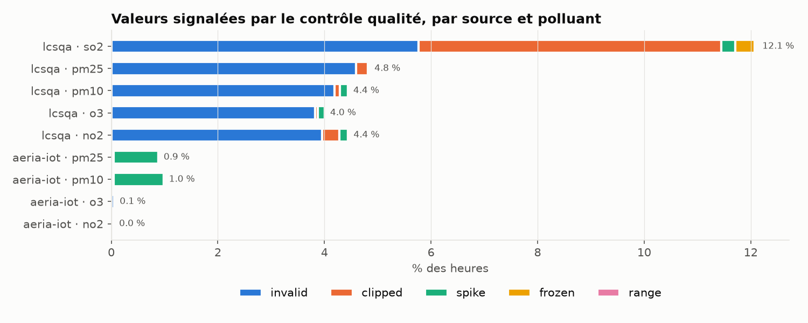
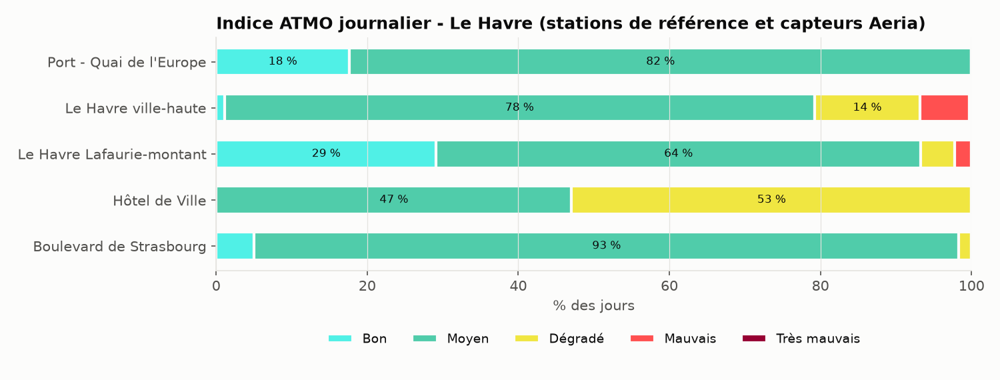
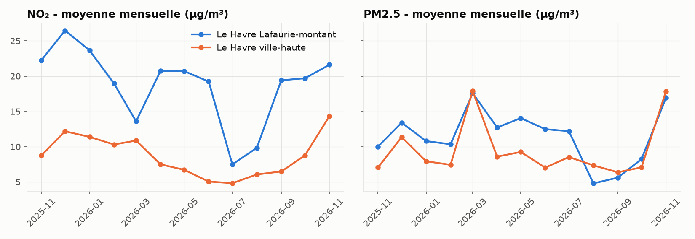
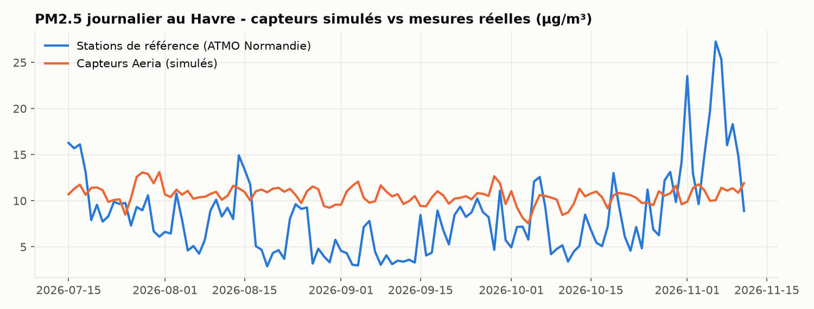

# Rapport — Module 2 : pipeline de données et entrepôt

**Projet Aeria** — plateforme ouverte de surveillance de la qualité de l'air
Auteur : BRINIS Aya — novembre 2026
Dépôt : <https://github.com/brinis-aya/aeria-data-pipeline>

---

## 1. Objectif

Le module 1 produit des mesures de capteurs basse coût. Seules, elles ne valent pas grand-chose : il faut
les confronter aux mesures **réglementaires**, les nettoyer, et les ranger dans un modèle qui se prête à
l'analyse et à l'apprentissage (module 3). Ce module construit donc un **ETL** complet :

- **Extraction** des données ouvertes officielles (LCSQA / Geod'air, data.gouv.fr) et des capteurs Aeria ;
- **Transformation** avec pandas : agrégation horaire, dédoublonnage, contrôle qualité, calcul de l'**indice ATMO** ;
- **Chargement** dans un **entrepôt PostgreSQL en étoile**, de façon idempotente et traçable.

Le périmètre retenu est la **Normandie** (Le Havre en particulier, cohérent avec le module 1), sur
**un an** : du 1er novembre 2025 au 11 novembre 2026.

## 2. Sources de données

### 2.1 LCSQA / Geod'air (open data)

Le Laboratoire Central de Surveillance de la Qualité de l'Air publie chaque jour un fichier
`FR_E2_AAAA-MM-JJ.csv` avec les moyennes horaires de **toutes** les stations réglementaires françaises
(Licence Ouverte 2.0). Constats après analyse d'un fichier :

| Caractéristique | Valeur observée | Conséquence |
|---|---|---|
| Taille | ~12 Mo / jour, ~4,5 Go / an | filtrage à la volée, seules les lignes utiles sont gardées |
| Format | `;`, BOM UTF-8, virgule décimale | décodage `utf-8-sig`, conversion `,` → `.` |
| Horodatage | heure TU | stockage en `timestamptz` UTC, conversion locale au calcul de l'indice |
| Validité | codes `1`, `4`, `-1` | voir ci-dessous |
| Normandie | 36 stations, 5 polluants | NO₂, O₃, PM10, PM2.5, SO₂ |

Le code de validité a demandé une vraie analyse. Une première version ne gardait que `validité = 1`, ce
qui écartait 14 % des valeurs normandes. En croisant avec le `code qualité` et les valeurs elles-mêmes :

| validité | code qualité | valeurs | interprétation |
|---|---|---|---|
| `1` | A ou R | présentes | valide |
| `4` | A ou R | présentes, plausibles (O₃ surtout) | pré-validée (contrôles automatiques seulement) |
| `-1` | N | **toutes absentes** | invalide |

Les données « temps réel » ne sont jamais validées manuellement ; les codes `1` et `4` sont donc
conservés, et le code d'origine est stocké pour pouvoir changer de règle plus tard.

### 2.2 Capteurs Aeria (module 1)

Lecture directe de la base opérationnelle (`measurement`, 69 684 lignes, 6 capteurs, mesure toutes les
15 min) ou, sans accès base, pagination sur l'API `GET /api/measurements/export?after=`. Les deux chemins
produisent le même format « long » que la source LCSQA : une ligne par (instant, station, polluant).

## 3. Architecture

```
extract/lcsqa.py ──┐
                   ├─▶ transform/clean.py ─▶ transform/atmo.py ─▶ load/warehouse.py ─▶ PostgreSQL (dw.*)
extract/sensors.py ┘    horaire, drapeaux       indice journalier     dimensions, COPY, upsert
                                                                       etl_run (traçabilité)
```

- **Cache** : chaque jour est téléchargé une fois, filtré, puis stocké en CSV gzip (47 Mo pour l'année
  au lieu de 4,5 Go). Une relance ne retélécharge rien ; un jour en erreur (502, timeout) est retenté
  3 fois puis repris au lancement suivant.
- **CLI** : `aeria-pipeline run --start … --end … --sources lcsqa aeria-iot`, avec `--no-load` pour
  produire uniquement les rapports CSV (qualité, complétude, indice).
- **Planification** : la CI GitHub Actions exécute chaque matin un run de bout en bout sur les derniers
  jours publiés, ce qui détecte aussi un changement de format de la source.

## 4. Nettoyage et contrôle qualité

Principe : **aucune ligne n'est supprimée**. Chaque valeur reçoit un drapeau unique, la valeur brute est
conservée (`value_raw`) et la valeur nettoyée (`value`) est vide si elle est inutilisable. On peut ainsi
toujours expliquer pourquoi une mesure a été écartée, et rejouer le nettoyage avec d'autres seuils.

| Drapeau | Règle | Justification |
|---|---|---|
| `invalid` | validité `-1` ou valeur absente | décision du producteur |
| `range` | > limite physique (ex. PM2.5 > 1000) ou < −2 µg/m³ | panne, saturation |
| `spike` | filtre de **Hampel** : écart à la médiane glissante sur 7 h > 4 σ robustes (1,4826 × MAD) **et** > 25 µg/m³ | pic isolé non physique ; le seuil absolu évite de signaler du bruit sur une série très plate |
| `frozen` | même valeur non nulle ≥ 6 h consécutives | capteur bloqué ; les zéros répétés (SO₂) sont normaux |
| `clipped` | −2 ≤ valeur < 0 → 0 | bruit des analyseurs autour de zéro |
| `ok` | — | — |

Le filtre de Hampel est appliqué sur une **grille horaire régulière** par série (source × station ×
polluant) : un trou de données ne rapproche pas artificiellement deux mesures éloignées. Les capteurs
sont d'abord moyennés à l'heure avec la **règle des 75 %** des réseaux réglementaires (au moins 3 mesures
sur 4).

**Résultats (902 607 valeurs horaires) :**



| Source | ok | clipped | invalid | spike | frozen | range |
|---|---|---|---|---|---|---|
| LCSQA | 94,46 % | 0,96 % | 4,37 % | 0,14 % | 0,05 % | 0,01 % |
| Capteurs Aeria | 99,45 % | — | 0,05 % | 0,51 % | — | — |

- Le **SO₂** est la série la plus « sale » (12 % signalés) : concentrations proches de zéro, d'où
  beaucoup de petites valeurs négatives ramenées à 0, et des capteurs plus souvent figés.
- Côté capteurs, le simulateur du module 1 injecte 2 % de mesures fautives. La validation à l'ingestion
  rejette déjà les valeurs impossibles ; la moyenne horaire dilue une partie des pics ; le filtre de Hampel
  retrouve le reste (PM : ~0,9 %). Les deux étages de contrôle sont donc complémentaires.
- Complétude médiane des séries : **98,7 %**. La plus faible (FR25036, 49 %) correspond à une station
  arrêtée plusieurs semaines, avec un trou maximal de 144 h.

## 5. Indice ATMO

L'indice ATMO (arrêté du 10 juillet 2020) est calculé par station et par **jour local** :

| Niveau | PM2.5 | PM10 | NO₂ | O₃ | SO₂ |
|---|---|---|---|---|---|
| 1 Bon | ≤ 10 | ≤ 20 | ≤ 40 | ≤ 50 | ≤ 100 |
| 2 Moyen | ≤ 20 | ≤ 40 | ≤ 90 | ≤ 100 | ≤ 200 |
| 3 Dégradé | ≤ 25 | ≤ 50 | ≤ 120 | ≤ 130 | ≤ 350 |
| 4 Mauvais | ≤ 50 | ≤ 100 | ≤ 230 | ≤ 240 | ≤ 500 |
| 5 Très mauvais | ≤ 75 | ≤ 150 | ≤ 340 | ≤ 380 | ≤ 750 |
| 6 Extrêmement mauvais | > 75 | > 150 | > 340 | > 380 | > 750 |

Agrégats : moyenne journalière pour les particules, maximum des moyennes horaires pour les gaz ; au moins
18 heures valides par jour ; l'indice global est le pire sous-indice et le polluant responsable est
enregistré. Une subtilité : certaines stations industrielles ne mesurent **que le SO₂** ; leur « indice »
repose sur un seul polluant et n'est pas comparable. Le nombre de sous-indices disponibles
(`n_pollutants`) est donc stocké, et les analyses ne retiennent que les jours avec au moins 3 polluants.

**Résultats (8 222 jours-stations avec indice complet, stations de référence) :**

| Bon | Moyen | Dégradé | Mauvais | Très mauvais |
|---|---|---|---|---|
| 18,0 % | 67,0 % | 10,6 % | 4,4 % | 0,1 % |

Polluant responsable : **O₃ 54,7 %**, PM2.5 31,6 %, NO₂ 7,8 %, PM10 5,8 %. L'ozone domine car son seuil
« Bon » (50 µg/m³) est très bas par rapport aux concentrations de fond habituelles.



## 6. Entrepôt de données

### 6.1 Modèle en étoile

Grain du fait principal : **une heure × une station × un polluant × une source**.

| Table | Rôle | Clé |
|---|---|---|
| `dim_date` | jour local, mois, semaine ISO, week-end, saison | `date_key` = aaaammjj |
| `dim_time` | heure UTC, heure locale, heure de pointe | `time_key` = aaaammjjhh (UTC) |
| `dim_station` | code, nom, réseau, zone, type, influence, référence / capteur | substitut, code naturel unique |
| `dim_pollutant` | code, libellé, unité, valeur guide OMS 2021 | substitut |
| `dim_source` | LCSQA, capteurs Aeria, licence | substitut |
| `dim_quality` | drapeau, utilisable oui/non, description | 0-5 |
| `fact_measurement` | `value_raw`, `value`, `run_id` | (time, station, polluant, source) |
| `fact_daily_index` | concentrations et sous-indices, indice, polluant responsable, `n_pollutants` | (date, station) |
| `etl_run` | période, sources, lignes extraites / chargées / utilisables, statut, durée | `run_id` |

Choix notables :

- **Clés temporelles « intelligentes »** (`2026102508`) : lisibles, triables, calculables sans
  jointure, et générées par le pipeline sans aller-retour en base.
- **Heure locale dans `dim_time`** : le passage à l'heure d'hiver (deux « 2 h » le 25 octobre) est géré
  par la conversion de fuseau, testé explicitement.
- **Qualité en dimension** plutôt qu'en booléen : un analyste peut choisir d'inclure ou non les valeurs
  `clipped`, ou étudier les pannes.
- Une vue `dw.v_measurement` reconstitue la table « plate » pour l'analyse ad hoc.

### 6.2 Chargement idempotent

Les dimensions sont insérées en `ON CONFLICT` sur leur clé naturelle ; les faits sont chargés par `COPY`
dans une table temporaire puis fusionnés (`INSERT … ON CONFLICT DO UPDATE`). Relancer une période
**met à jour** au lieu de dupliquer — vérifié : après relance d'une semaine, 902 607 faits et
13 543 indices, comptes inchangés. Chaque exécution est tracée dans `etl_run` (statut `failed` et
rollback en cas d'erreur).

### 6.3 Performances

| Étape | Durée (année complète) |
|---|---|
| Extraction (depuis le cache) | 2,8 s |
| Transformation (nettoyage + indice) | 3,0 s |
| Chargement (902 607 + 13 543 lignes) | 2 min 17 s |

Le chargement domine. La table de faits occupe 129 Mo index compris. Un run quotidien (≈ 2 500 lignes)
prend environ une seconde.

## 7. Analyses

Requêtes dans [`sql/queries.sql`](../sql/queries.sql).

**Le Havre, moyennes mensuelles.** La station de trafic Lafaurie-montant mesure 2 à 3 fois plus de NO₂
que la station de fond ville-haute (22 contre 9 µg/m³ en novembre 2025), alors que les PM2.5 sont
proches : les particules fines sont surtout un polluant de fond, le NO₂ un marqueur du trafic. Les deux
stations montrent le pic de particules de **mars 2026** (~18 µg/m³) et l'épisode de **novembre 2026**.



**Profil journalier du NO₂.** Les jours ouvrés ont deux pics, à 8 h (19 µg/m³) et 18 h (16 µg/m³), qui
disparaissent presque le week-end (11 µg/m³ à 9 h). C'est la signature du trafic pendulaire, retrouvée
sans aucune donnée de trafic. Cette variable « heure × jour ouvré » sera directement utile au module 3.

**Valeur guide OMS.** Sur les stations de référence, la moyenne journalière de PM2.5 dépasse la valeur
guide OMS 2021 (15 µg/m³) sur 639 des 6 267 jours-stations mesurés (10 %), dont 283 au printemps
(18 % des jours de printemps, contre 5 % l'été). Les épisodes printaniers de particules sont un phénomène
connu en Normandie ; l'entrepôt permet de les quantifier, pas d'en établir la cause.

**Capteurs simulés contre mesures réelles.** Sur la même période, les capteurs Aeria restent autour de
10-11 µg/m³ en PM2.5, alors que les stations réelles varient de 3 à 27 µg/m³ et montent fortement début
novembre. C'est attendu : le simulateur suit un modèle saisonnier, pas la météo réelle. Ce graphique
montre la limite des données simulées et justifie que le module 3 soit entraîné sur les **mesures
réglementaires réelles**.



## 8. Tests et intégration continue

35 tests pytest :

- **extraction** : filtrage réseau / polluant / type de valeur, virgule décimale, UTC, codes de validité,
  aller-retour par le cache sans second téléchargement ;
- **nettoyage** : détection d'un pic, non-détection d'un petit saut, capteur figé, zéros répétés non
  signalés, négatifs, hors plage, doublons, indépendance des séries, règle des 75 % ;
- **indice ATMO** : 14 cas aux bornes des seuils (10 → Bon, 10,6 → Moyen…), moyenne contre maximum,
  minimum de 18 h, jour local ;
- **entrepôt** : clés et heure locale au changement d'heure, et un test d'intégration PostgreSQL qui
  charge deux fois les mêmes données et vérifie l'absence de doublons.

GitHub Actions lance ces tests avec un conteneur PostgreSQL, puis un run réel sur les derniers jours
publiés, tous les matins.

## 9. Difficultés rencontrées

- **Volume** : 4,5 Go par an pour toute la France, sur un poste avec peu d'espace disque. Solution :
  filtrage à la volée et cache gzip (100 fois plus petit).
- **Disponibilité de la source** : erreurs 502 et timeouts ponctuels de `files.data.gouv.fr` pendant le
  téléchargement de l'année ; résolu par les reprises et le cache (un jour manquant est repris au run suivant).
- **Sémantique de la validité** : voir §2.1, une règle trop stricte faisait perdre 14 % des données.
- **Heure locale contre UTC** : stocker en UTC, ne convertir qu'aux calculs qui en dépendent (jour ATMO,
  profils horaires).

## 10. Limites et suites

- L'indice est calculé **par station**, alors que l'indice officiel est publié **par commune**, à partir
  de modèles de dispersion. Les valeurs sont donc indicatives.
- Les données temps réel sont pré-validées ; les données consolidées (publiées l'année suivante) pourront
  remplacer ces lignes grâce au chargement idempotent.
- Ajouter d'autres régions ne demande qu'une option (`--agency`) ; une source internationale (OpenAQ)
  pourrait être branchée sur le même format long.
- Le chargement pourrait être accéléré en désactivant les index pendant le chargement initial.

## 11. Lien avec les autres modules

- **Module 1** : source `aeria-iot` (lecture de la base ou de l'API d'export).
- **Module 3 (prévision 24 h)** : jeu d'entraînement = `fact_measurement` des stations du Havre, cible =
  indice ATMO ; les profils montrés ici guident les variables (heure, jour ouvré, saison).
- **Module 6 (tableau de bord)** : `fact_daily_index` et `v_measurement` alimentent la carte et les graphiques.
- **Module 5 (sécurité)** : la base est exposée uniquement sur `127.0.0.1` ; les identifiants passent par
  variables d'environnement.
